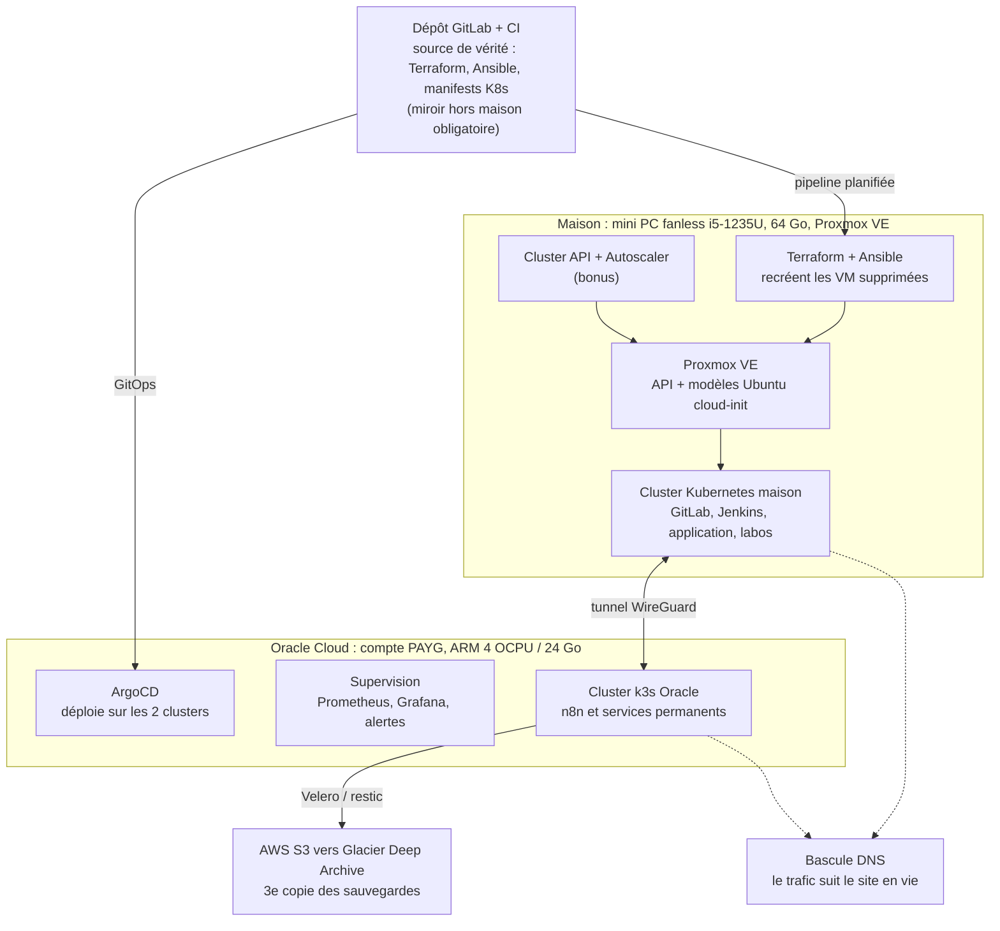

# Architecture hybride du labo (version 2)

24 novembre 2026 · alex · remplace l'architecture cible de la [feuille de route](feuille-de-route.md) du 5 novembre

Schémas interactifs : [Whiteboard « Labo DevOps hybride »](https://claude.ai/artifact/UvvHrThMQCmjJbDcrS63od)

Principe : **tout est décrit dans Git, tout se reconstruit seul.** Chaque site est autonome pour ce qu'il fait tourner, et les sites se sauvegardent mutuellement.

## Vue d'ensemble

## Détail de la machine maison

| Bloc | Contenu |
|---|---|
| VM services CI/CD | GitLab CE (dépôts, CI, registre d'images), Jenkins, runner IaC (Terraform + Ansible) |
| VM supervision | Prometheus, Grafana |
| VM load balancer | HAProxy + keepalived, adresse virtuelle des masters |
| Cluster Kubernetes | 3 masters (etcd réparti), workers, worker-n ajouté par l'autoscaler, Ingress NGINX, stockage persistant (Longhorn ou NFS), sauvegardes (snapshots etcd + Velero) |

## Où vit chaque service

| Service | Où il tourne | Sa base | Copie de secours |
|---|---|---|---|
| n8n (toujours allumé) | Oracle | PostgreSQL sur Oracle | Réplique maison + AWS Glacier |
| GitLab, Jenkins | Maison | Locale | Sauvegardes vers Oracle + AWS Glacier |
| Application du projet | Maison (dev, qa, staging, prod) | PostgreSQL (CloudNativePG) | Réplique Oracle + AWS |
| Labos, tests destructifs | Maison | Locale | Aucune : tout se reconstruit depuis Git |

Règle : la base reste à côté de son application, l'autre site garde une copie.

## Scénario de bascule vers AWS (test trimestriel)

1. Maison en panne : pipeline « DR » lancée depuis GitLab.com
2. `terraform apply` : k3s sur EC2
3. Velero restaure depuis S3 Standard (7 derniers jours)
4. ArgoCD redéploie depuis le miroir Git
5. Bascule DNS vers AWS
6. Maison revenue : `terraform destroy`

Prérequis : miroir Git hors maison, 7 derniers jours de sauvegardes en S3 Standard (le reste passe en Glacier Deep Archive par une règle de cycle de vie).

## Limites connues

- Une seule machine physique : pas de haute disponibilité Proxmox (3 nœuds requis pour le quorum). La HA se joue au niveau Kubernetes et entre les sites.
- Pas d'etcd partagé entre la maison et Oracle : deux clusters séparés, synchronisés par ArgoCD.
- Images multi-architecture obligatoires (x86 à la maison, ARM chez Oracle).
- Disponibilité exprimée en RTO et RPO mesurés, pas en « toujours disponible ».

## Matériel retenu

| Élément | Choix | Prix indicatif |
|---|---|---|
| Machine | Mini PC fanless i5-1235U en DDR4, fixation rail DIN : MNBOXCONET (sous réserve de confirmation du vendeur), sinon CWWK 6 ports i226-V | 420 à 470 € |
| RAM | 2 × 32 Go SO-DIMM DDR4-3200 | environ 310 € |
| Stockage | NVMe et SSD 2,5" déjà disponibles | 0 € |

Le processeur est soudé : on le choisit bien dès le départ. Prix relevés le 24/11/2026, à revérifier à l'achat. Écartés : DDR5 (prix de la RAM trop élevés), modèles SFP+ (la Freebox n'a pas de port SFP+ côté réseau local), PC industriels Siemens ou OnLogic (prix et mémoire limitée).
