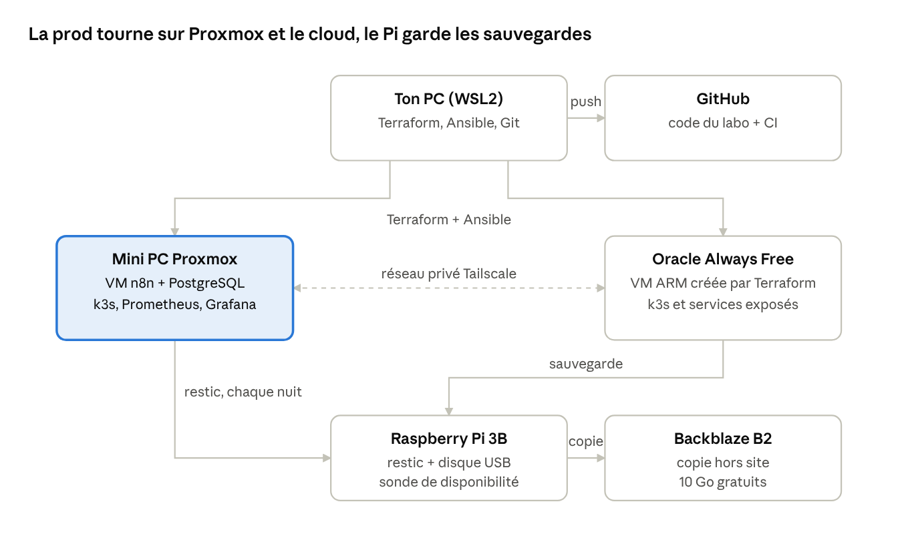
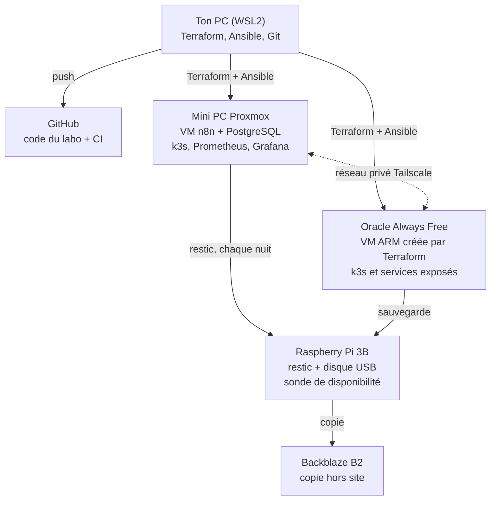

# Feuille de route du labo DevOps

5 novembre 2026 · alex · version de travail ([doc en ligne](https://claude.ai/artifact/9JT2FTeCMn6sQJhKjN5nL9))

> **Mise à jour du 24 novembre 2026 :** l'architecture et le matériel ont évolué. Voir [architecture-hybride.md](architecture-hybride.md) et le [journal](journal.md). Les étapes 0 à 4 restent valables ; le Pi et Backblaze B2 sont remplacés par Oracle et AWS S3 pour les sauvegardes, et le mini PC devient un fanless i5-1235U avec 64 Go.

Le labo passe d'un Pi 3 qui fait tout à une architecture hybride en 9 étapes, pour environ 200 à 300 € au total, presque entièrement le mini PC. Chaque étape ajoute un outil demandé dans les offres DevOps et laisse une trace dans Git.

Point de départ : n8n tourne sur le Pi 3 (1 Go, Docker, Tailscale), documenté dans le dépôt `pi3-n8n`. Le plan est en mode bac à sable : rien n'est déployé tant que tu ne donnes pas le feu vert.

Les prix et les offres gratuites sont donnés de mémoire, donc approximatifs. On les vérifie au moment de chaque inscription ou achat.

## Architecture cible

Les données existent en trois copies : la prod sur Proxmox et le cloud, la sauvegarde sur le Pi, la copie hors site sur B2. Tout est créé depuis ton PC par Terraform et Ansible, et le code vit sur GitHub.

## Les étapes

Les étapes 0 à 2 se font avec ce que tu as déjà, sans rien acheter. Chacune s'appuie sur la précédente.

### 0. Poste de travail

- **Outils :** WSL2 (Ubuntu) sur ton PC Windows, Terraform ou OpenTofu, Ansible, VS Code avec l'extension WSL.
- **Coût :** 0 €.
- **Apport CV :** un poste DevOps Linux, comme en entreprise.
- **Piège :** Ansible ne tourne pas sous Windows natif, il lui faut WSL.
- **Fini quand :** `terraform version` et `ansible --version` répondent dans WSL.

### 1. CI sur le dépôt pi3-n8n

- **Outils :** GitHub Actions, pre-commit, yamllint, PSScriptAnalyzer pour `sync-n8n.ps1`, gitleaks pour les secrets, `docker compose config` pour valider le compose.
- **Coût :** 0 € (2 000 minutes par mois offertes sur un dépôt privé).
- **Apport CV :** CI/CD et DevSecOps, visibles sur GitHub.
- **Piège :** passer gitleaks sur tout l'historique, pas seulement le dernier commit.
- **Fini quand :** chaque push déclenche une CI verte, et une clé de test volontairement ajoutée la fait échouer.

### 2. Ansible : le RUNBOOK en code

- **Outils :** Ansible (rôles `base`, `durcissement-ssh`, `docker`, `tailscale`, `n8n`), Molecule pour tester, une VM jetable (Hyper-V ou VirtualBox) comme cible.
- **Coût :** 0 €.
- **Apport CV :** gestion de configuration et idempotence.
- **Piège :** ne jamais lancer le playbook sur le Pi en production sans `--check --diff` d'abord.
- **Fini quand :** une VM vierge devient un serveur n8n complet en une commande, sans étape manuelle du RUNBOOK.

### 3. Cloud gratuit avec Terraform

- **Outils :** compte Oracle Cloud, Terraform (réseau, pare-feu, VM ARM), cloud-init, état Terraform stocké hors du PC.
- **Coût :** 0 €. Oracle Always Free donne une VM ARM jusqu'à 4 cœurs et 24 Go (de mémoire, à vérifier).
- **Apport CV :** IaC sur un vrai cloud.
- **Pièges :** la carte bancaire est demandée à l'inscription, la capacité ARM est parfois saturée selon la région, et une VM gratuite inactive peut être récupérée par Oracle. Il faut aussi activer une alerte de budget à 0 €.
- **Fini quand :** `terraform destroy` puis `terraform apply` recrée la VM à l'identique, et Ansible la configure.

### 4. Migration de n8n et passage à PostgreSQL

- **Outils :** Docker Compose, PostgreSQL, copie du volume `n8n_data`, Tailscale.
- **Coût :** 0 €.
- **Apport CV :** une migration de service avec bascule et retour arrière.
- **Piège :** garder la même `N8N_ENCRYPTION_KEY` et la même URL Tailscale, sinon les credentials et le connecteur MCP cassent.
- **Fini quand :** la veille du lundi part de la nouvelle machine et le Pi n'héberge plus n8n.

### 5. Le Pi devient le nœud de sauvegarde

- **Outils :** restic, un disque USB, Backblaze B2 pour la copie hors site, un timer systemd, une petite sonde de disponibilité.
- **Coût :** environ 50 € pour un disque de 1 To. B2 est gratuit jusqu'à 10 Go.
- **Apport CV :** une stratégie 3-2-1 avec des restaurations testées.
- **Piège :** le Pi 3 a de l'USB 2 et un Ethernet à 100 Mbit/s. C'est lent mais suffisant pour une sauvegarde nocturne. Il faut aussi une alimentation solide pour le disque.
- **Fini quand :** une restauration complète de n8n depuis le Pi, puis depuis B2, a été faite et chronométrée.

### 6. Mini PC sous Proxmox

- **Outils :** Proxmox VE, templates cloud-init, Terraform avec le provider `bpg/proxmox`, Ansible.
- **Coût :** environ 150 à 250 € en reconditionné (Lenovo M720q ou M920q, HP EliteDesk mini, 16 à 32 Go de RAM).
- **Apport CV :** virtualisation pilotée par le code, et pas à la souris.
- **Piège :** viser au moins 16 Go de RAM et un SSD NVMe, et vérifier la consommation électrique au repos.
- **Fini quand :** une VM se crée depuis Terraform et se configure par Ansible sans toucher l'interface Proxmox.

### 7. Kubernetes et GitOps

- **Outils :** k3s (sur la VM ARM cloud ou sur Proxmox), Helm, Argo CD.
- **Coût :** 0 €.
- **Apport CV :** Kubernetes et GitOps, la ligne la plus demandée dans les offres.
- **Piège :** ne pas mettre la veille n8n sur k3s avant que la sauvegarde de l'étape 5 soit testée.
- **Fini quand :** un commit dans Git déploie une application sur k3s sans commande manuelle.

### 8. Observabilité

- **Outils :** Prometheus, node_exporter, Grafana, Loki, Alertmanager (ou Grafana Cloud en gratuit).
- **Coût :** 0 €.
- **Apport CV :** monitoring et alerting.
- **Piège :** ne pas installer Prometheus sur le Pi 3, il n'a pas la mémoire. Seul l'exporter y tourne.
- **Fini quand :** une alerte arrive par mail quand une sauvegarde échoue ou qu'une machine tombe.

## Budget

Le labo complet coûte environ 200 à 300 € en une fois, plus l'électricité. Les montants sont approximatifs.

| Poste | Coût estimé | Quand |
| --- | --- | --- |
| Mini PC reconditionné (16 à 32 Go) | 150 à 250 € | Étape 6 |
| Disque USB 1 To pour le Pi | environ 50 € | Étape 5 |
| Oracle Always Free, GitHub Actions, Backblaze B2 jusqu'à 10 Go, Grafana Cloud gratuit | 0 € | Étapes 1, 3, 5, 8 |
| Tous les logiciels (Terraform, Ansible, Proxmox, k3s, Prometheus…) | 0 € | Toutes |

## Pièges transverses

- **Les secrets :** on garde ta règle actuelle (rien dans Git). Quand les fichiers de configuration en contiendront, on passera à SOPS + age.
- **Les coûts cachés :** une alerte de budget à 0 € sur chaque compte cloud, et un `terraform destroy` pour tout ce qui ne sert plus.
- **L'exposition :** on reste derrière Tailscale, sans nouveau port ouvert sur la Freebox, et on coupe le Funnel s'il ne sert plus au connecteur.
- **La documentation :** le RUNBOOK reste la référence et gagne une section par étape, avec ses pièges.
- **À vérifier le jour J :** les conditions des offres gratuites d'Oracle, d'AWS et d'Azure, ainsi que les prix du mini PC.

## Prochaine étape

On commence par les étapes 0 et 1, gratuites et sans risque pour le Pi. Quand tu sortiras du mode bac à sable, je préparerai la CI du dépôt `pi3-n8n` sur une branche, pour que tu la relises avant de fusionner.

- [ ] Installer WSL2 et Ubuntu sur le PC
- [ ] Choisir entre Terraform et OpenTofu
- [ ] Donner le feu vert pour la CI du dépôt `pi3-n8n`
